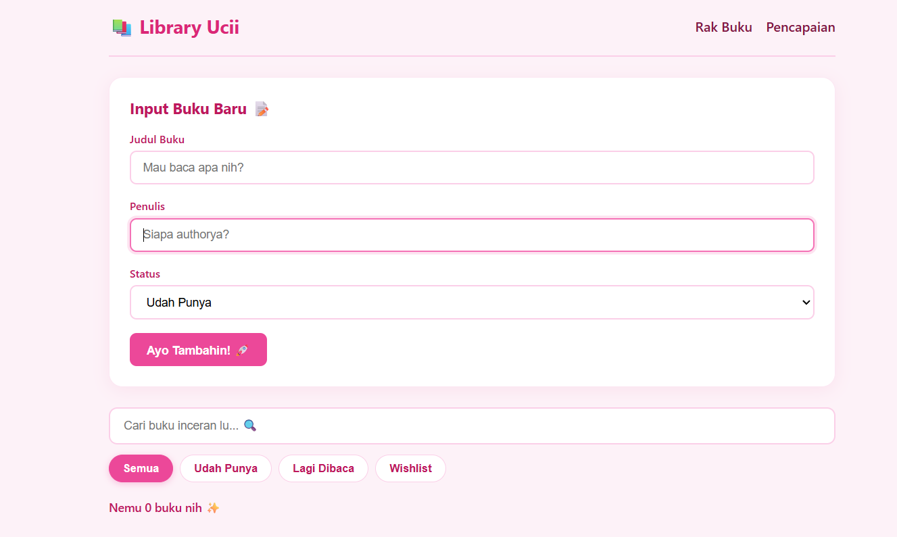
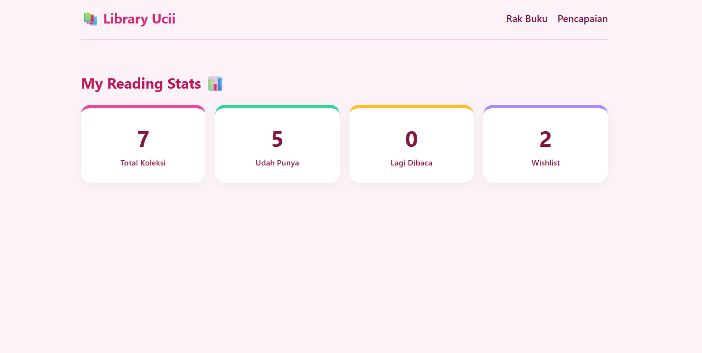
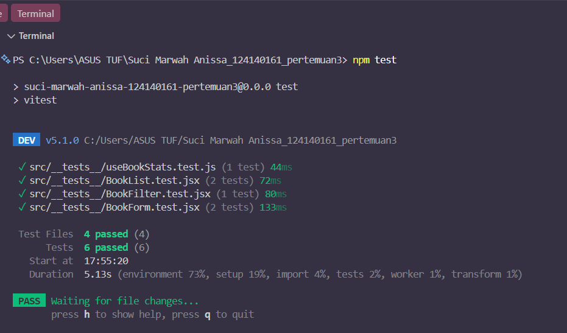

markdown
# 📚 Library Ucii - Aplikasi Manajemen Buku Pribadi

Tugas Pertemuan 3 - Pemrograman Web (React)

- **Nama:** Suci Marwah Anissa
- **NIM:** 124140161

## 📖 Deskripsi Aplikasi
**Library Ucii** adalah aplikasi manajemen buku pribadi berbasis web yang dibangun menggunakan React. Aplikasi ini dirancang dengan antarmuka yang modern dan estetik. Pengguna dapat mencatat koleksi buku pribadi mereka ke dalam tiga kategori status: **Udah Punya** (milik), **Lagi Dibaca** (baca), dan **Wishlist** (beli).

Aplikasi ini juga dilengkapi dengan fitur pencarian, filter berdasarkan status, halaman statistik, serta penyimpanan data yang persisten menggunakan `localStorage` (data tidak hilang saat halaman di-refresh).

## 🚀 Instruksi Instalasi & Cara Menjalankan

1. Pastikan Anda sudah menginstal **Node.js** di komputer.
2. Buka terminal dan masuk ke direktori project ini.
3. Install semua dependensi yang dibutuhkan:
   ```bash
   npm install
   npm install react-router-dom prop-types
   npm install -D vitest @testing-library/react @testing-library/jest-dom jsdom
4. Jalankan server pengembangan (development server):
   ```bash
   npm run dev
   Buka browser dan akses http://localhost:5173/.


📸 Screenshot Antarmuka
## 📸 Screenshot Antarmuka
1. Halaman Utama (Rak Buku)


2.Halaman Statistik (Pencapaian)


3. Hasil Unit Testing


⚛️ Penjelasan Fitur React yang Digunakan
Aplikasi ini dibangun murni menggunakan Functional Components dan React Hooks. Berikut adalah rincian penerapan konsep React-nya:

1. useState
Digunakan untuk mengelola state lokal di dalam komponen.
Contoh: Pada BookForm.jsx, useState digunakan untuk menyimpan nilai input form (judul, penulis, status) dan state untuk pesan error. Pada Home.jsx, digunakan untuk menyimpan state filter status dan kata kunci pencarian (search).
2. useEffect
Digunakan untuk menangani side effects.
Contoh: Pada BookForm.jsx, useEffect dipakai untuk mendeteksi jika user menekan tombol "Edit", maka form otomatis terisi dengan data buku yang dipilih. Pada custom hook useLocalStorage.js, useEffect dipakai untuk otomatis menyimpan data ke localStorage setiap kali state buku berubah.
3. Context API
Digunakan untuk state management global agar tidak terjadi prop drilling (mengoper props secara berantai dari atas ke bawah).
Contoh: BookContext.jsx menyimpan state utama books beserta fungsi addBook, updateBook, dan deleteBook. Komponen mana pun bisa mengaksesnya menggunakan custom hook useBooks().
4. React Router DOM
Digunakan untuk membuat aplikasi multi-halaman (Single Page Application).
Contoh: Di App.jsx, terdapat konfigurasi <Routes> dan <Route>. Ada dua halaman utama: / (Beranda) dan /stats (Statistik). Navigasi antar halaman menggunakan komponen <Link>.
5. Custom Hooks
Kita membuat 2 custom hooks untuk memisahkan logika dari tampilan (UI):
useLocalStorage.js: Membungkus useState dan useEffect agar data otomatis tersinkronisasi dengan localStorage browser secara persisten.
useBookStats.js: Menggunakan useMemo untuk menghitung total buku dan jumlah buku per status secara efisien (hanya dihitung ulang jika data buku berubah).
6. PropTypes
Digunakan untuk melakukan type checking pada props yang diterima komponen, memastikan data yang masuk sesuai format yang diharapkan.
Contoh: Di BookList.jsx, kita mendefinisikan bahwa books harus berupa array of object dengan properti id (number), judul (string), penulis (string), dan status (salah satu dari 'udah punya', 'lagi dibaca', atau 'wishlist
7. Error Handling Form
Validasi input diterapkan pada BookForm.jsx. Jika pengguna mencoba menekan tombol submit saat kolom judul atau penulis masih kosong, form tidak akan diproses. Sebagai gantinya, akan muncul feedback visual berupa border input berwarna merah dan teks peringatan (error message).
8. Unit Testing
Pengujian dilakukan menggunakan Vitest dan React Testing Library. Terdapat 6 unit test untuk menguji fungsionalitas komponen dan custom hook:
BookForm.test.jsx (2 test: validasi form kosong & submit data valid)
BookList.test.jsx (2 test: render daftar buku & tampilan saat kosong)
BookFilter.test.jsx (1 test: memastikan tombol filter berfungsi)
useBookStats.test.js (1 test: memastikan kalkulasi statistik akurat)

Untuk menjalankan testing, gunakan perintah:
bash
npm test