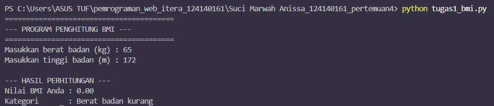
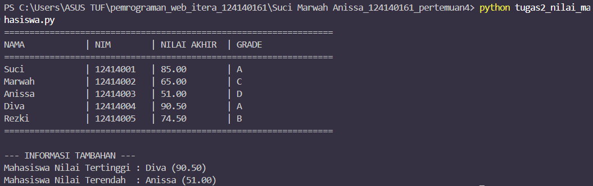
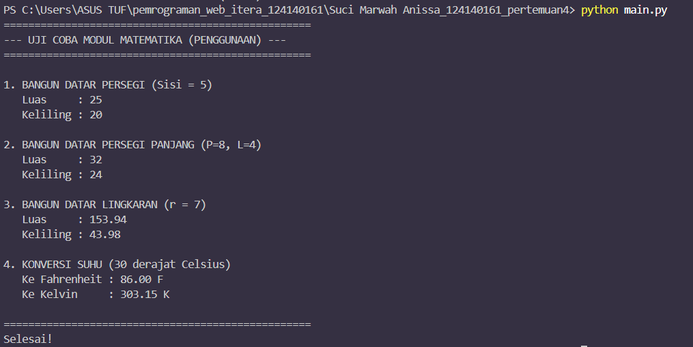

markdown
# Tugas Praktikum Python - Pertemuan 4

- **Nama:** Suci Marwah Anissa
- **NIM:** 124140161

## 📖 Deskripsi Singkat
Repositori ini berisi kumpulan tugas praktikum dasar pemrograman Python. Kode ditulis dengan mematuhi standar PEP 8 (indentasi 4 spasi dan penamaan snake_case), menggunakan fungsi modular, serta dilengkapi dengan docstring dan *type hinting*.

1. **`tugas1_bmi.py`**: Program untuk menghitung nilai BMI dan kategorinya. Alur kerjanya meminta input berat (kg) dan tinggi (m), lalu memprosesnya menggunakan fungsi `hitung_bmi` dan menentukan kategorinya lewat fungsi `tentukan_kategori` menggunakan struktur if-elif-else.
2. **`tugas2_nilai_mahasiswa.py`**: Program pengelolaan nilai. Menggunakan struktur data *list of dictionary* untuk menyimpan data 5 mahasiswa. Terdapat fungsi `hitung_nilai_akhir` (bobot 30% UTS, 40% UAS, 30% Tugas) dan `tentukan_grade`. Hasilnya dicetak dalam format tabel yang rapi dan mencari nilai tertinggi/terendah.
3. **`math_operations.py` & `main.py`**: Implementasi modul kustom. File `math_operations.py` berisi fungsi geometri (persegi, persegi panjang, lingkaran), konversi suhu, dan konstanta `PI`. File `main.py` bertugas memanggil modul tersebut menggunakan 2 metode import (import utuh dan import fungsi spesifik).

## 🚀 Instruksi Cara Menjalankan Skrip di VS Code
Buka terminal terintegrasi di VS Code, pastikan Python sudah terinstal di sistem Anda, lalu jalankan perintah berikut:

**Menjalankan Soal 1 (BMI):**
python tugas1_bmi.py

**Menjalankan Soal 2 (Nilai Mahasiswa):**
python tugas2_nilai_mahasiswa.py

**Menjalankan Soal 3 (Modul Matematika):**
python main.py

📸 Screenshot Bukti Eksekusi
1. Hasil Eksekusi Soal 1 (BMI)

2. Hasil Eksekusi Soal 2 (Nilai Mahasiswa)

3. Hasil Eksekusi Soal 3 (Modul Matematika)
