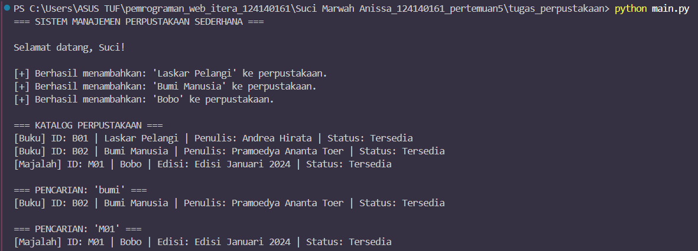
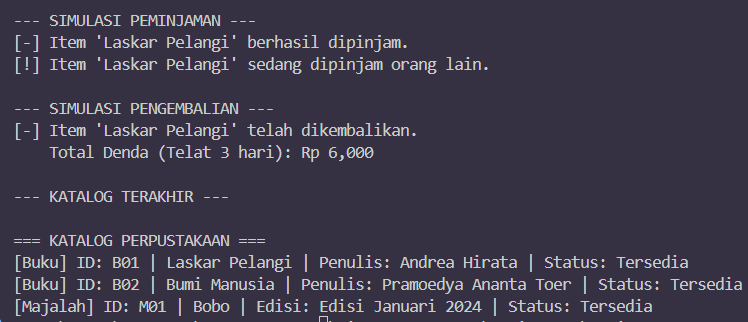

markdown
# Tugas Praktikum Python OOP - Pertemuan 5

- **Nama:** Suci Marwah Anissa
- **NIM:** 124140161
- **Kelas Praktikum:** RA

## 📖 Deskripsi Program
Program ini adalah **Sistem Manajemen Perpustakaan Sederhana** yang dibangun menggunakan paradigma *Object-Oriented Programming* (OOP) di Python. Program memungkinkan pengguna untuk menambahkan koleksi (buku/majalah), melihat katalog, mencari item, serta melakukan simulasi peminjaman dan pengembalian beserta perhitungan dendanya.

### Penerapan 4 Pilar OOP:
1. **Abstraction (Abstraksi):** Diimplementasikan pada `library_item.py` menggunakan `LibraryItem(ABC)`. Class ini menyembunyikan detail spesifik dari buku/majalah, dan hanya menyediakan *blueprint* berupa method `get_detail()` dan `hitung_denda()`.
2. **Inheritance (Pewarisan):** Class `Book` dan `Magazine` mewarisi semua atribut dan method dasar dari `LibraryItem` menggunakan fungsi `super()`.
3. **Encapsulation (Enkapsulasi):** Atribut `__koleksi` pada class `Library` dibuat *private* (tidak bisa diubah sembarangan dari luar). Atribut `_is_dipinjam` dibuat *protected*, dan diakses menggunakan *decorator* `@property` dan `@is_dipinjam.setter`.
4. **Polymorphism (Polimorfisme):** Di dalam method `tampilkan_katalog()` pada `library.py`, program melakukan perulangan pada list `__koleksi` dan memanggil `item.get_detail()`. Method yang sama ini merespons berbeda tergantung apakah objeknya `Book` atau `Magazine`.

## 🚀 Panduan Menjalankan Program
Buka terminal di VS Code, lalu jalankan perintah berikut:

**1. Masuk ke folder tugas:**
```bash
cd tugas_perpustakaan
```

**2. Jalankan program utama:**
```bash
python main.py
```

📸 Screenshot Output

1. Hasil Eksekusi Penambahan & Katalog


2. Hasil Eksekusi Peminjaman & Denda
